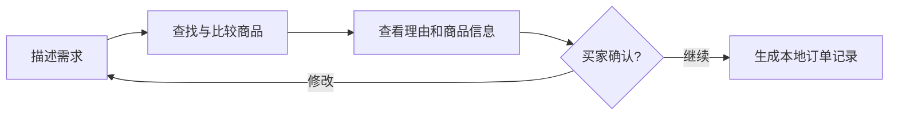

# Mall Work

> 面向跨境购物场景的 AI 导购工作台：把自然语言需求转成可比较、可确认的商品选择。

<p align="center">
  <strong>Describe what you need. Compare with confidence. Confirm when ready.</strong>
</p>

Mall Work 是一个跨境电商导购原型。买家可以描述预算、用途、收货地区和个人偏好，系统据此查找并比较商品，回答品类问题，并在买家确认后生成订单记录。

## ✨ 能做什么

| 能力 | 体验 |
| --- | --- |
| 🛍️ 自然语言选品 | 用日常语言描述用途、预算和目的地，查看符合条件的商品候选。 |
| ⚖️ 商品比较 | 在同一会话里查看商品卡片、规格与价格信息，比较不同选择。 |
| 💬 品类问答 | 获取选购思路、参数解释和注意事项，并关联到可查看的商品。 |
| 🧠 个性化偏好 | 记录、修改或删除长期偏好，也可以维护个人购物 Skill。 |
| ✅ 明确确认 | 在提交订单前展示确认信息；需要买家明确操作才会继续。 |
| 🔄 对话恢复 | 页面刷新或网络短暂中断后，可以继续读取会话进度。 |

## 🧭 体验流程



## 🧱 项目组成

```text
Web 界面  →  API 与 Agent 工作流  →  商品和品类知识检索
                          ├── 会话与偏好
                          └── 订单确认记录
```

完整项目使用 React、TypeScript、FastAPI 和 Python 构建，并通过 AG-UI 协议传递流式回复、商品信息与确认状态。

## 🎯 项目范围

当前版本是可运行的业务原型，商品目录和品类知识使用样例数据，订单保存在本地账本中。它用于演示导购交互、商品发现和确认流程，不接入真实商品供给、支付、物流、商家后台或真实账号体系。

价格、库存、税费和配送信息以原型数据为准，不代表真实交易报价或履约承诺。

## 🖥️ 交互界面

项目界面围绕买家工作区组织，包括对话、商品卡片、比较视图、偏好管理和订单确认。

## 🔒 公开范围与不开源内容

公开版本包含项目介绍和部分源码：

| 路径 | 内容 |
| --- | --- |
| `frontend/` | React 页面、客户端交互和前端测试 |
| `app/domain/` | 通用领域模型及端口定义 |

以下内容不随当前 `main` 分支公开发布，仅在完整开发版本中维护：

| 不开源内容 | 范围 |
| --- | --- |
| Agent 编排与业务策略 | 主 Agent、子 Agent 调度、上下文、记忆与权限策略 |
| 系统提示词 | 完整 Prompt、工具使用约定及 Prompt 版本管理 |
| 检索与质量控制 | 商品与知识检索、排序、缓存、运行护栏和相关基础设施实现 |
| 后端业务实现 | 应用层用例与工具、API、依赖装配、持久化和 worker |
| 评测与验证 | 评测脚本、数据集、标注、发布门槛、后端回归测试及内部报告 |
| 部署与内部资料 | 服务端部署配置、设计文档、运行数据、凭据和个人工作记录 |

公开版本不包含完整后端，不能直接启动完整导购系统。前端真实交互需要配套后端服务，页面中的接口调用也不代表公开提供在线服务。

## 📌 当前状态

- 可运行的跨境导购原型
- 支持商品检索、比较、品类问答与本地确认流程
- 仍需验证真实商品数据、身份体系和线上履约集成

---

<p align="center"><sub>Built as an exploration of practical AI shopping experiences.</sub></p>
